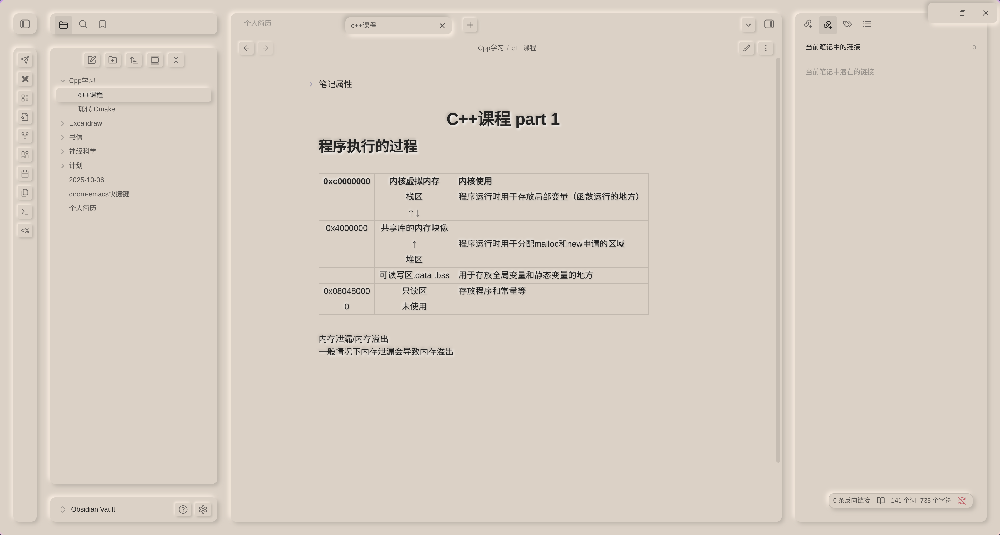
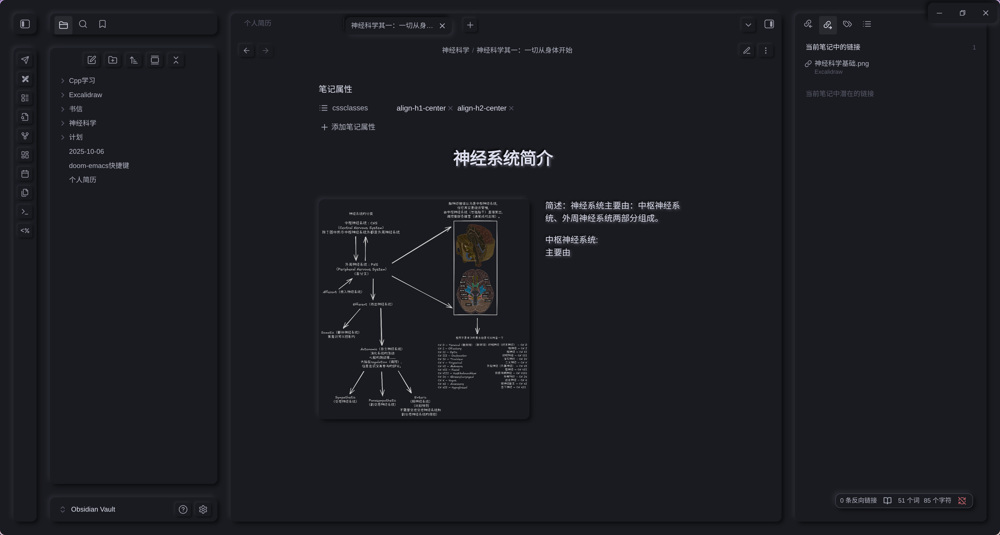
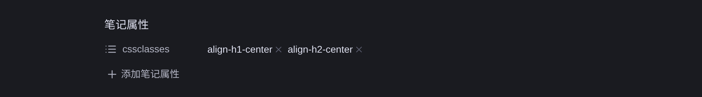
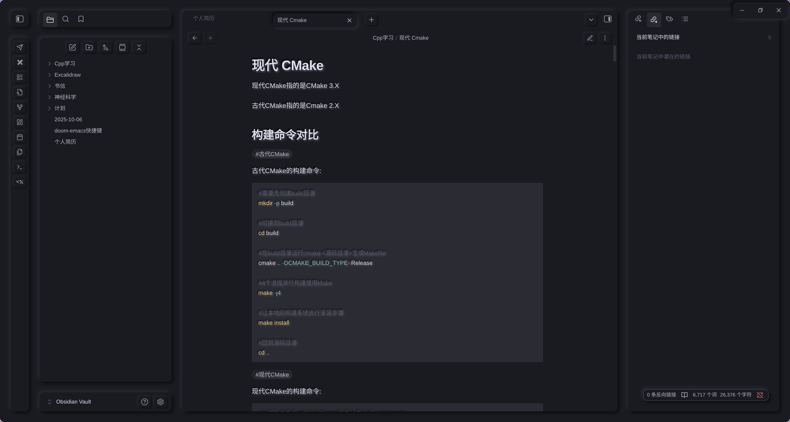

# NichNeumor Theme
[English](README.md) • [简体中文](README_zh.md)

<p align="center">
  
  
  
</p>

- light theme


- dark theme


## Theme Features

### 🎨 Skeuomorphic Visual Design
- **Light and Dark Mode**: Perfect support for both light and dark themes
- **Physical Button Interaction**: All buttons provide realistic press feedback effects
- **Floating Menu System**: Menus naturally emerge from paper background with clear hierarchy
- **Embossed Images**: Inserted images feature raised effects for enhanced dimensionality
- **Printer-style Tables**: Tables adopt printed output styling for paper-like texture

### 🖋️ Focused Writing Experience
- **Low Saturation Color Scheme**: Reduced visual distraction for focused content creation
- **Typewriter Input Effects**: Satisfying keypress animations with tactile feedback
- **Centered Headers**: Intelligent title centering through note properties

### 🖼️ Advanced Image Layout
Support flexible image floating positioning syntax for professional image-text layout:
- **Float Positioning**: Supports multiple image alignment options (left, right, center)
- **Precise Size Control**: Customizable image display dimensions
- **Text Wrapping**: Enables professional image-text mixed layout

### 🎯 Plugin Perfect Compatibility
- **Excalidraw**: Seamless hand-drawn diagram integration
- **Better Export PDF**: Optimized PDF export quality (#TODO: Add light/dark theme switching and font printing support)
- **ProZen**: Deep focus mode adaptation
- **Style Settings**: Personalized styling adjustments

## Installation

1. In Obsidian settings, go to `Settings` → `Appearance`
2. Click `Manage` → `Browse Community Themes`
3. Search for `NichNeumor` and install
4. Enable the theme and enjoy the new writing experience

## Usage Guide

### Header Centering
Add to your note's frontmatter properties:

### Image Floating Layout
Use extended syntax to control image position and size:

```Markdown
![img.png|left&center&right|300(You can set the size)]
```

### Basic Markdown Syntax Support
The theme fully supports all standard Markdown syntax elements:
- **Text Styles**: Bold, italic, highlight, strikethrough, etc.
- **List Systems**: Ordered lists, unordered lists, todo lists
- **Header-aligned Support**: Left-aligned, right-aligned, center-aligned headers



- **Code Highlighting**: Fine-tuned Nord color scheme



### Custom Palette

Colours and neumorphic shadows are generated from a small palette block at the top of `theme.css` (`=== PALETTE ===`), using the same maths as [neumorphism.io](https://neumorphism.io):

- dark shadow = base colour x (1 - intensity)
- light shadow = base colour x (1 + intensity), clamped at white

```css
--nn-light-bg: #dbd1c6;          /* light background */
--nn-dark-bg: #1a1b20;           /* dark background */
--nn-light-shadow-strength: 15;  /* light intensity, % */
--nn-dark-shadow-strength: 60;   /* dark intensity, % */

--nn-distance: 4px;              /* panel shadow offset */
--nn-blur: 8px;                  /* panel shadow blur */
--nn-button-distance: 2px;       /* button shadow offset */
--nn-button-blur: 4px;
```

Change the two backgrounds (and optionally the intensity / distance / blur) and every panel, button, active tab and titlebar shadow is regenerated — there is no shadow colour to pick.

If the [Style Settings](https://github.com/mgmeyers/obsidian-style-settings) plugin is enabled, the same options are also available as a GUI (two backgrounds + eight accent colours + shadow strength / distance / blur) — see "Using the Style Settings Plugin" below.

The whole Obsidian colour scale (`--color-base-*`: text, borders, selected items, inputs) is derived from the two backgrounds as well, so a new background colour recolours the entire theme instead of just the page behind the panels. The Style Settings controls themselves use the same neumorphic styling.

Example — soft neutral grey scheme:

```css
--nn-light-bg: #e0e0e0;
--nn-distance: 10px;
--nn-blur: 24px;
```

### Using the Style Settings Plugin

[Style Settings](https://github.com/mgmeyers/obsidian-style-settings) is a separate community plugin by mgmeyers — it is **not** bundled with the theme. The theme works without it (defaults live in `theme.css`); with it enabled you can recolour and re-tune everything from a GUI.

**Install and open**

1. `Settings → Community plugins → Browse`, search for **Style Settings** (by mgmeyers), install and enable it;
2. `Settings → Style Settings → NichNeumor Palette`.

**What you can change**

- **Backgrounds** — light background and dark background, both text fields. Any CSS colour works: `#bf616a`, `rgb(191 97 106)`, `hsl(354 30% 64%)`, `oklch(0.75 0.09 20)`, `rebeccapurple`…;
- **Accent colours** — red / orange / yellow / green / cyan / blue / purple / pink. One field per colour, applied to both light and dark themes;
- **Shadows** — light/dark shadow intensity, panel shadow distance/blur, button shadow distance/blur (sliders).

**How it applies**

- A colour is applied when you press `Enter` or click outside the field; the field always shows the value currently in use;
- The whole `--color-base-*` scale (text, borders, selections, inputs) and every shadow are derived from the background colour, using the same maths as [neumorphism.io](https://neumorphism.io) — there is no shadow colour to pick;
- Invalid or out-of-range values fall back to the theme defaults (registered with `@property`).

**Reset**

Clear a field (or enter an invalid value) to fall back to the default, or remove the saved override in `.obsidian/plugins/obsidian-style-settings/data.json` (keys starting with `nichneumor-palette@@`).

> The theme hides Style Settings' own search / import / export row because Obsidian's built-in settings search already covers it. If you need import/export, switch to another theme temporarily, or edit `data.json` directly.

## Technical Features

- **Responsive Design**: Adapts to various screen sizes
- **Performance Optimized**: Smooth animation transitions
- **Accessibility**: WCAG standards compliant
- **Customizable Colors**: Supports personalized color schemes

## Development Notes

This theme is built with modern CSS techniques to ensure perfect compatibility with the Obsidian ecosystem. Refer to community styles for implementation details.

## Contribution & Feedback

Welcome to submit issues or feature suggestions via GitHub to help improve this Obsidian theme focused on writing experience.

---

*Make note-taking a delight with NichNeumor's ultimate focus experience*

Your every donation guarantees the next meal for the little raccoon | Thank you! | Vielen Dank! | Grazie! | ありがとうございます！ | 감사합니다!

Alipay


wechat


paypal: [check](https://www.paypal.com/paypalme/nichtigott)
