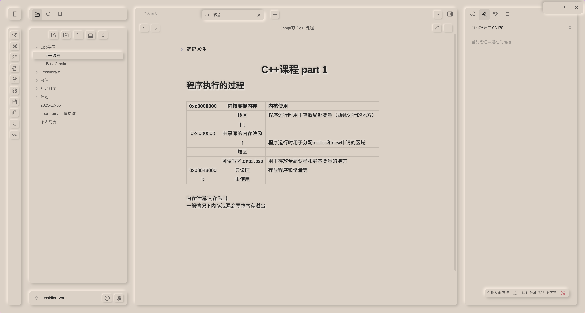
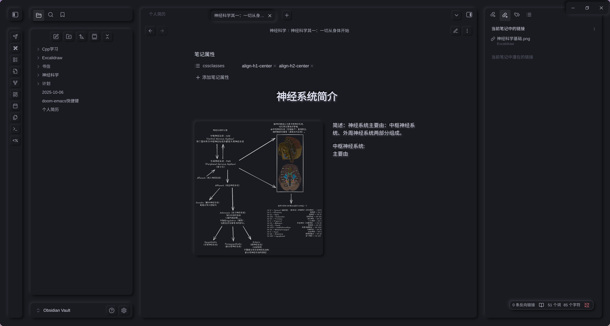
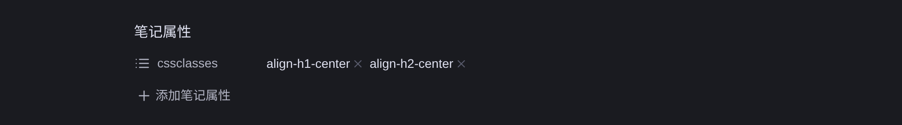
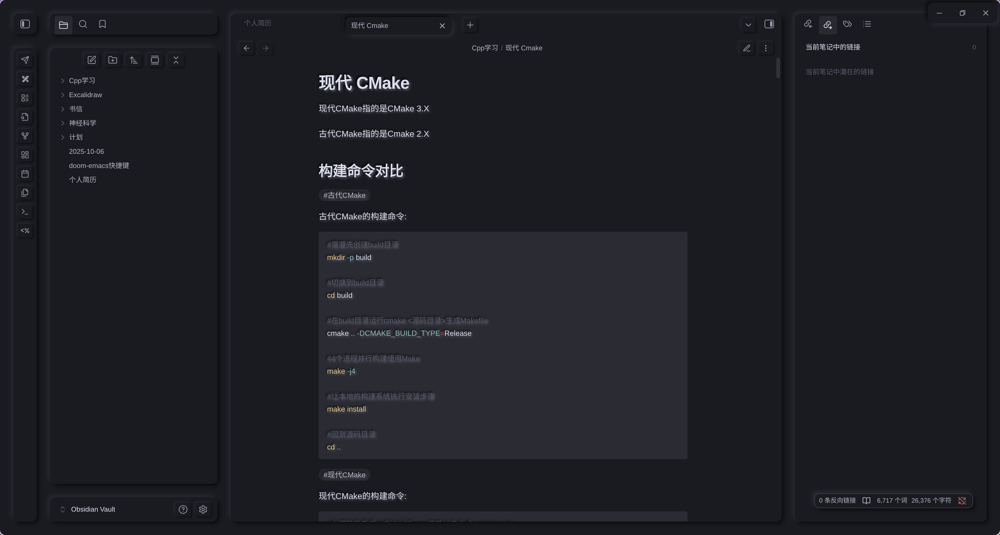

# NichNeumor Theme / NichNeumor 主题
[English](README.md) • [简体中文](README_zh.md)

<p align="center">
  
  
  
</p>

- light theme


- dark theme


## 主题特色 / Theme Features

### 🎨 拟物化视觉设计 / Skeuomorphic Visual Design
- **浅色和深色模式**：完美支持浅色和深色模式
- **实体按钮交互**：所有按钮都具有真实的按压反馈效果
- **浮动菜单系统**：菜单从纸张背景中自然浮现，层次分明
- **浮雕式图片**：插入的图片呈现浮雕效果，增强立体感
- **打印机风格表格**：表格采用打印输出样式，突出纸张质感

### 🖋️ 专注写作体验 / Focused Writing Experience
- **低饱和度配色**：减少视觉干扰，专注于内容创作
- **打字机输入效果**：键盘输入带有解压的按压动画反馈
- **标题居中显示**：通过笔记属性实现标题智能居中排版

### 🖼️ 高级图片排版 / Advanced Image Layout
支持灵活的图片浮动定位语法，实现专业的图文混排效果
- **浮动定位**：支持左右居中多种图片对齐方式
- **尺寸精确控制**：可自定义图片显示尺寸
- **文字环绕**：实现专业的图文混排效果

### 🎯 插件完美兼容 / Plugin Perfect Compatibility
- **Excalidraw**：手绘图表无缝集成
- **Better Export PDF**：优化PDF导出效果( #TODO 需要增加明暗主题切换、和对字体打印样式的支持 )
- **ProZen**：专注模式深度适配
- **Style Settings**：个性化样式调整

## 安装方法 / Installation

1. 在Obsidian设置中进入「外观」→「主题」
2. 点击「管理」→「浏览社区主题」
3. 搜索「NichNeumor」并安装
4. 启用主题并享受全新的写作体验

## 使用指南 / Usage Guide

### 标题居中功能 / Header Centering
在笔记属性中添加：
### 图片浮动排版 / Image Floating Layout
使用扩展语法控制图片位置和大小：

```Markdown
![img.png|left&center&right|300(You can set the size)]
```

### Markdown 基础语法支持 / Basic Markdown Syntax Support
主题完美支持所有标准Markdown语法元素：
- **文本样式**：粗体、斜体、高亮、删除线等
- **列表系统**：有序列表、无序列表、待办事项
- **标题对齐支持**：左对齐、右对齐、居中对齐标题



- **代码高亮**：精调过的nord颜色方案



### 自定义配色 / Custom Palette

颜色和拟物阴影都由 `theme.css` 顶部的 `=== PALETTE ===` 区块生成，算法和 [neumorphism.io](https://neumorphism.io) 一致：

- 暗影 = 底色 × (1 − intensity)
- 亮影 = 底色 × (1 + intensity)（超过白色会 clamp）

```css
--nn-light-bg: #dbd1c6;          /* 亮色背景 */
--nn-dark-bg: #1a1b20;           /* 暗色背景 */
--nn-light-shadow-strength: 15;  /* 亮色强度（%） */
--nn-dark-shadow-strength: 60;   /* 暗色强度（%） */

--nn-distance: 4px;              /* 大面板阴影偏移 */
--nn-blur: 8px;                  /* 大面板阴影模糊 */
--nn-button-distance: 2px;       /* 小按钮阴影偏移 */
--nn-button-blur: 4px;
```

只改两个背景色（需要的话再加强度/距离/模糊），所有面板、按钮、选中 tab、标题栏的阴影都会自动重算，不需要手选阴影颜色。

启用 [Style Settings](https://github.com/mgmeyers/obsidian-style-settings) 插件后，同样的项目也可以全部在图形界面里调（背景色 + 8 个语义色 + 阴影强度/距离/模糊），见下面的「使用 Style Settings 插件」。

Obsidian 的整套 `--color-base-*`（文字、边框、选中项、输入框等）也会从这两个背景色按比例推导，所以换底色会整体换掉主题配色，而不只是面板后面的页面。Style Settings 的控件本身也套用了同样的拟物样式。

示例——柔和中性灰配色：

```css
--nn-light-bg: #e0e0e0;
--nn-distance: 10px;
--nn-blur: 24px;
```

### 使用 Style Settings 插件 / Using the Style Settings Plugin

[Style Settings](https://github.com/mgmeyers/obsidian-style-settings) 是 mgmeyers 的独立社区插件，**不包含在主题包里**。不装它主题也能正常用（默认值写在 `theme.css` 里）；装了之后可以在图形界面里重新配色、调阴影。

**安装与打开**

1. `设置 → 第三方插件 → 浏览`，搜索 **Style Settings**（作者 mgmeyers），安装并启用；
2. `设置 → Style Settings → NichNeumor Palette`。

**可以调什么**

- **背景**：亮色背景、暗色背景，都是文本输入框。支持任意 CSS 颜色：`#bf616a`、`rgb(191 97 106)`、`hsl(354 30% 64%)`、`oklch(0.75 0.09 20)`、`rebeccapurple` 等；
- **语义色**：红 / 橙 / 黄 / 绿 / 青 / 蓝 / 紫 / 粉，每个颜色一个输入框，同时作用于亮色和暗色主题；
- **阴影**：亮色/暗色阴影强度、大面板阴影距离/模糊、按钮阴影距离/模糊（滑杆）。

**生效方式**

- 颜色输入后按回车、或点别处即生效；输入框里始终显示当前实际在用的值；
- 整套 `--color-base-*`（文字、边框、选中项、输入框等）和所有阴影都由背景色自动推导，算法同 [neumorphism.io](https://neumorphism.io)，没有「阴影颜色」需要手选；
- 输入非法或越界值会回退到默认值（用 `@property` 注册兜底）。

**恢复默认**

清空某项（或输入非法值）会回退默认；也可以删除插件保存的覆盖项——`.obsidian/plugins/obsidian-style-settings/data.json` 里以 `nichneumor-palette@@` 开头的条目。

> 主题隐藏了 Style Settings 自带的「搜索 / 导入 / 导出」那一行（与 Obsidian 自带设置搜索重复）。需要导入/导出时，可以临时切到别的主题操作，或直接编辑上面提到的 `data.json`。

## 技术特性 / Technical Features

- **响应式设计**：适配不同屏幕尺寸
- **性能优化**：流畅的动画过渡效果
- **可访问性**：符合WCAG标准
- **主题色定制**：支持个性化色彩配置

## 开发说明 / Development Notes

该主题采用现代CSS技术实现，确保与Obsidian生态系统的完美兼容。
参考社区样式：

## 贡献与反馈 / Contribution & Feedback

欢迎通过GitHub提交问题反馈或功能建议，共同完善这个专注于写作体验的Obsidian主题。

---

*让笔记写作成为一种享受，NichNeumor主题为您打造极致的专注体验*  
*Make note-taking a delight with NichNeumor's ultimate focus experience*

您的每一次捐赠都是小浣熊下一顿的保障 | 谢谢！| Thank you！| Vielen Dank! | Grazie！| ありがとうございます！| 감사합니다！

Alipay


wechat


paypal: [check](https://www.paypal.com/paypalme/nichtigott)
